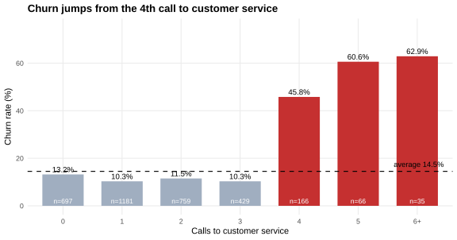
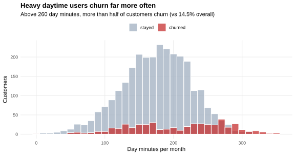
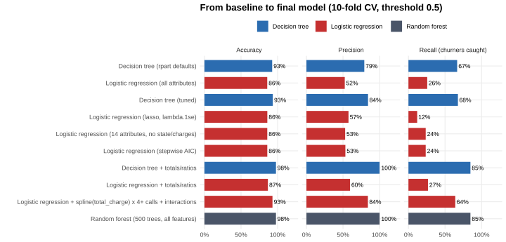
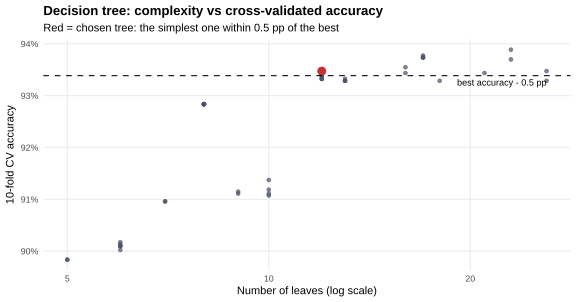
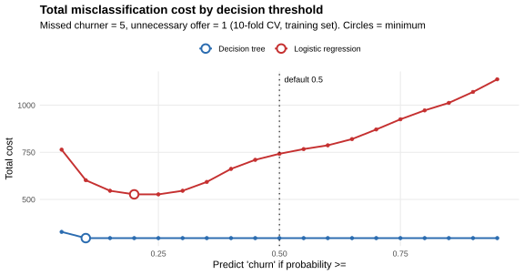
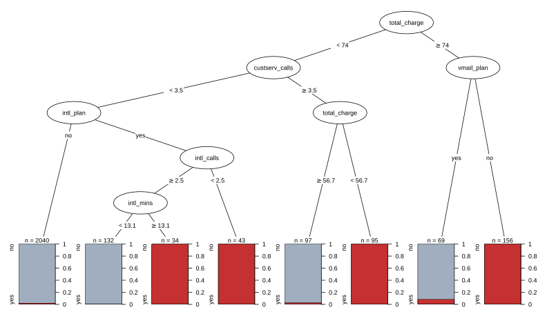
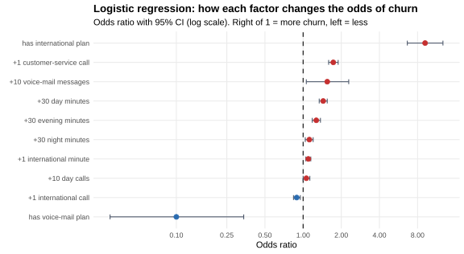
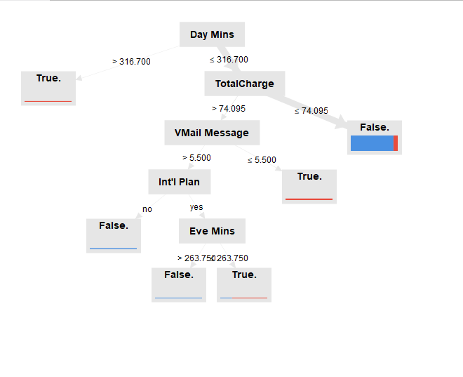
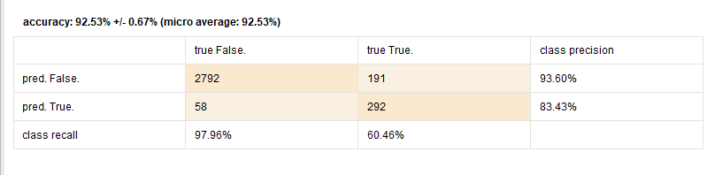
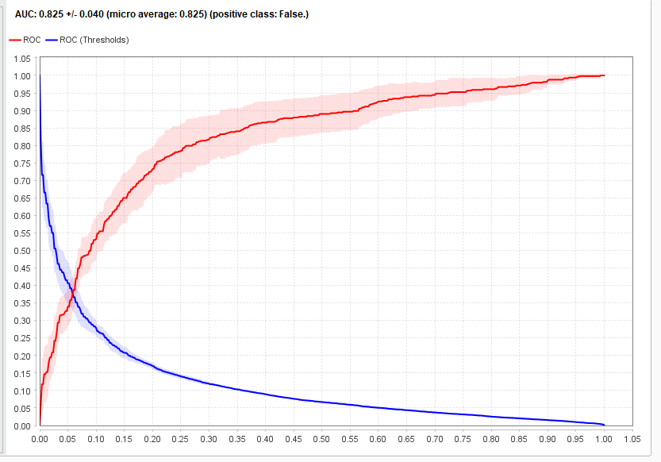

# Telecom customer churn prediction: decision tree vs logistic regression

**Which customers are about to leave, and why? This project builds classification models first in RapidMiner and then again in reproducible R. It compares them, tunes them for the cost of each kind of error, and turns the model into retention actions.**


## Results

All results below are on the **test set: 667 customers (20% of the data) that were held out before any modelling**. A model that always predicts "no churn" is 85.5% accurate, so accuracy alone says little here. Recall (how many of the churners the model finds) is what matters most.

| Final model | Accuracy | Precision | Recall | ROC AUC |
|---|---|---|---|---|
| **Decision tree** (8 rules) | **97.5%** | **100%** | **82.5%** | 0.92 |
| Logistic regression with non-linear terms | 93.7% | 91.0% | 62.9% | 0.92 |
| … same model, threshold 0.2 instead of 0.5 | 92.5% | 70.8% | **82.5%** | 0.92 |
| Random forest, 500 trees (benchmark) | 97.5% | 100% | 82.5% | 0.90 |

**Main findings**

- **Feature construction made the biggest difference.** Adding the customer's *total monthly charge* raised the tree's recall from 68% to 85% in cross-validation. After that, a random forest added nothing.
- **Three segments hold 86% of all churners**, and they make up only 12.5% of the customer base. Section 9 lists them.
- **The tree beats logistic regression because churn follows thresholds, not straight lines.** Four or more service calls are a warning sign only for low spenders. For high spenders, a voice-mail plan almost removes the risk. A linear model can only match this after the non-linear terms are written into it by hand.
- **Moving the threshold works for logistic regression, not for the tree.** Lowering the logistic regression threshold from 0.5 to 0.2 cuts the total misclassification cost by 37% on the test set. The tree's leaves are almost pure, so its threshold barely matters.

**Skills shown:**
- Classification in R: `rpart`, `glm`, `glmnet`, `ranger`, `pROC`.
- Model evaluation: stratified cross-validation, a held-out test set, precision/recall/F1, ROC and PR AUC.
- Model building: hyperparameter tuning against complexity, attribute selection (domain reasoning and stepwise AIC), and feature engineering.
- Cost-sensitive classification: threshold moving and loss-matrix training.
- Interpretation and business recommendations from a model. The same steps were also done in **RapidMiner**.

---

## The data

The dataset has 3,333 customers of a telecom operator with 20 attributes: plans, minutes, calls, charges per time of day, and calls to customer service. The target is `Churn?`. **14.5% of customers churned.** It is the classic MLC++ churn dataset (used in Larose & Larose, *Discovering Knowledge in Data*). Its source describes it as "artificial, based on claims similar to the real world".

Two data-quality findings decided the attribute selection:

- **`Phone` is a unique identifier** (3,333 different values). In the RapidMiner attribute weighting it got the *highest* weight (0.597). Information-based weights always favour a column that is unique for each row. It has no predictive value, so it is removed.
- **Each `charge` column is exactly `tariff × minutes`** (day 0.17, evening 0.085, night 0.045, international 0.27 per minute; R² = 1.000). It repeats the minutes column and adds no information.

| | |
|---|---|
|  |  |

Two signals are visible before any model:
- At **4 or more calls to customer service**, churn rises from about 11% to 46-64% (4 to 6 calls).
- Above **260 daytime minutes**, more than half of the customers leave.
- Customers with an **international plan** churn at 42%, against 11.5% for the others.

## How the models were built (`R/02_models.R`)

**Protocol.** First, 20% of the customers (stratified) were locked away as a test set. All modelling choices were made with **10-fold stratified cross-validation** on the remaining 2,666 customers. The test set was used once, at the end.



| Step | What was done | Result (CV) |
|---|---|---|
| **1-2 Baseline** | A tree with default settings, and a logistic regression on all attributes | Tree 92.6% accuracy and 67% recall. Logistic regression 85.9% accuracy, which is about the same as always predicting "no churn". |
| **3 Tuning** | 48 tree configurations (complexity cp, max depth, min leaf size). **I chose the smallest tree within 0.5 pp of the best accuracy.** Lasso regularisation for logistic regression. | The tree went from 23 leaves to 12 for −0.4 pp accuracy. The lasso did not help. |
| **4 Attribute selection** | Removed phone, the 4 charge columns and state (51 levels, about 7 churners per state). Then backward stepwise selection by AIC. | Logistic regression: 19 → 10 attributes at the same accuracy (85.9%). AIC dropped account length, area code, and evening and night calls. |
| **5 Attribute construction** | Total minutes, calls and charge; average call length; international share of minutes. For logistic regression also: a spline on total charge, a "4+ service calls" flag, and interactions. | **Tree: 97.8% accuracy, 85% recall.** Logistic regression: 93.0% accuracy, 64% recall. |
| Benchmark | Random forest with 500 trees | 97.8% accuracy and 85% recall, the same as the single tree |



**Why logistic regression stays behind.** Every linear version of the model (steps 1-4, with or without lasso, with or without stepwise selection) finds only 12-27% of churners. Logistic regression adds up straight-line effects. Here, the risk switches on above certain values and depends on combinations of attributes. Once the non-linearity is written into the formula, logistic regression reaches 93% accuracy. The cut-off values were not picked by hand: the model uses a spline on total charge and interactions.

## Step 6: making expensive errors rarer (`R/03_costs.R`)

Missing a churner costs the customer's future revenue. Flagging a loyal customer costs one retention offer. As an illustration, I assumed that **a missed churner costs 5× as much as an unnecessary offer**. Both numbers are parameters at the top of the script.



| Strategy (test set) | Threshold | Total cost | Precision | Recall |
|---|---|---|---|---|
| Logistic regression, default | 0.5 | 186 | 91.0% | 62.9% |
| **Logistic regression, cost-optimal threshold** | **0.2** | **118 (−37%)** | 70.8% | **82.5%** |
| Decision tree, default | 0.5 | 85 | 100% | 82.5% |
| Decision tree trained with a loss matrix (the idea behind MetaCost) | – | 85 | 100% | 82.5% |

I chose the threshold of 0.2 with cross-validation, before looking at the test set. In theory, the optimal threshold for well-calibrated probabilities is 1/(1+5) ≈ 0.17, which is close. The tree does not react to the threshold or to the costs, because its leaves are almost pure (0-9% or 100% churn). The tree is already making the right decisions.

## Steps 7-8: what the models say, and do they agree? (`R/04_interpret.R`)

### Decision tree



The tree has eight leaves. **Four of them are pure churn segments:**

| Rule (training set) | Customers | Churn |
|---|---|---|
| Total charge ≥ 74 **and** no voice-mail plan | 156 | 100% |
| Total charge < 56.7 **and** 4+ calls to customer service | 95 | 100% |
| International plan **and** fewer than 3 international calls | 43 | 100% |
| International plan, 3+ international calls **and** ≥ 13.1 international minutes | 34 | 100% |
| *All other customers (4 leaves)* | 2,338 | 0.8-8.7% |

### Logistic regression



This model is linear and interpretable. Its main effects:
- An international plan multiplies the odds of churn by **9.2**.
- **Each** call to customer service multiplies the odds by **1.73**.
- 30 more daytime minutes multiply the odds by 1.44.
- A voice-mail plan cuts the odds to **0.10×**.

The positive coefficient for the number of voice-mail messages reflects collinearity with the plan: only customers with the plan have messages. It should not be read on its own.

### Do they agree?

**On which factors matter, yes.** Both models and a random forest (permutation importance) put spending or minutes, customer-service calls, the international plan and the voice-mail plan at the top. This is also what the RapidMiner models found.

**On how these factors act, no. The tree shows something the regression cannot:**

| Customers (all 3,333) | Total charge < 56.7 | 56.7-74 | ≥ 74 |
|---|---|---|---|
| 0-3 service calls | 5.0% churn | 5.9% | 75.1% |
| **4+ service calls** | **100%** | **3.2%** | 68.0% |

Many service calls mean churn **only for low spenders**. For the logistic regression, every extra call raises the risk by the same factor for everyone. To make a decision, the tree's version is the one to act on.

## Step 9: how to prevent churn

| Segment | Customers | Share of base | Churn rate | Share of all churners | Suggested action |
|---|---|---|---|---|---|
| High spenders without voice-mail (charge ≥ 74, no VM plan) | 200 | 6.0% | 100% | **41.4%** | Loyalty discount or a bundle at a fixed price. Include voice-mail, which marks the high spenders who stay. |
| Unhappy low spenders (4+ service calls, charge < 56.7) | 117 | 3.5% | 100% | **24.2%** | After the 3rd call, escalate to a senior agent with authority to solve the problem. Track repeated callers. |
| International plan, < 3 calls or ≥ 13.1 min | 111 | 3.3% | 100% | **23.0%** | Review international pricing. Light users pay for a plan they don't use, heavy users hit its limits. |
| **Total** | **417** | **12.5%** | | **86.3%** | |

As an operating model: use the **tree rules** as triggers for the CRM, because they are simple and explainable to the business. Use the **logistic regression probability** to rank the remaining customers for campaigns, with the threshold set by the cost of an offer.

## The original RapidMiner work (`rapidminer/`)

This started as a course project in *Business Intelligence Systems* (MSc Information Systems and Business Analytics). I built every step first as a RapidMiner process:

| Step | Decision tree | Logistic regression |
|---|---|---|
| 1-2 Model and performance | `01_decision_tree`, `02_decision_tree_performance`, `00_decision_tree_train_test`, `00_decision_tree_split_data` | `01_logistic_regression`, `02_logistic_regression_performance`, `00_logistic_regression_train_test`, `07_logistic_regression_cross_validation` |
| 3 Parameter optimisation (grid search + CV) | `03_decision_tree_parameter_optimization` | `03_logistic_regression_parameter_optimization` |
| 4 Attribute selection (Optimize Selection) | `04_decision_tree_feature_selection` | `04_logistic_regression_feature_selection` |
| 5 Attribute construction | `05_decision_tree_feature_construction` | `05_logistic_regression_feature_construction` |
| 6 Threshold and costs | `06_decision_tree_threshold`, `06_decision_tree_metacost` | `06_logistic_regression_threshold` |

To run them, import `data/churn.csv` into the RapidMiner repository as `churn_model` with `Churn?` as the label. The step 5 processes expect the constructed attributes to already exist in `churn_model`. The R code builds them explicitly in `add_features()`.

| RapidMiner tree after feature construction | Its performance (CV) | Threshold analysis |
|---|---|---|
|  |  |  |

**Comparing RapidMiner and R:**
- The conclusions are the same. Feature construction was the turning point: in RapidMiner the tree went from 3.9% to 60% recall, and total charge became the second split.
- The logistic regression coefficients match. RapidMiner gave international plan +2.05, customer-service calls +0.51 and day minutes +0.013. R gives +2.22, +0.55 and +0.012.
- The R version adds three things: a held-out test set, the removal of `Phone` as an identifier, and a cost-based choice of the threshold instead of a fixed one.
- RapidMiner's *default* decision tree found almost no churners (3.9% recall), while R's default tree found 67%. The defaults and pre-pruning of the two implementations differ. This is a reminder that a "baseline" depends on the tool.

## Limitations

- **The data is synthetic.** Its pure 100%-churn leaves are not what real churn data looks like. On real data, expect smaller differences between the models and a bigger role for probability ranking and thresholds.
- **The 5:1 cost ratio is an assumption.** With real offer costs, customer lifetime value and offer acceptance rates, the threshold should be recomputed. The script is built for that.
- **One snapshot in time.** There is no tenure history or time to churn. A survival model would be the next step with real data.

## Reproduce

```r
install.packages(c("rpart", "ranger", "pROC", "glmnet", "partykit", "ggplot2", "svglite", "scales"))
```

```bash
Rscript run_all.R     # about 1 minute; writes output/ and figures/
```

```
├── run_all.R
├── R/
│   ├── 00_setup.R          # data loading, feature construction, CV folds, metrics
│   ├── 01_explore.R        # churn rate, data-quality checks, first drivers
│   ├── 02_models.R         # steps 1-5: baselines, tuning, selection, construction, test set
│   ├── 03_costs.R          # step 6: threshold moving vs cost-sensitive training
│   └── 04_interpret.R      # steps 7-9: tree rules, odds ratios, agreement, segments
├── rapidminer/             # original RapidMiner processes (.rmp) and screenshots
├── data/churn.csv          # 3,333 customers
├── figures/                # SVG charts used in this README
└── output/                 # all tables and printed results
```

---

**Author:** Ivana Ercegovac · MSc Information Systems and Business Analytics
